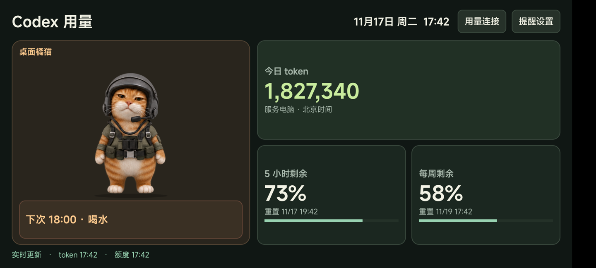
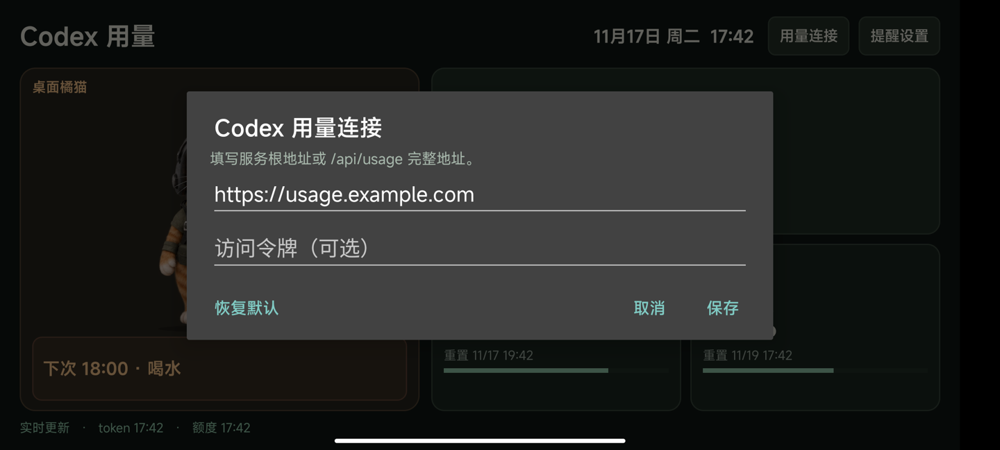
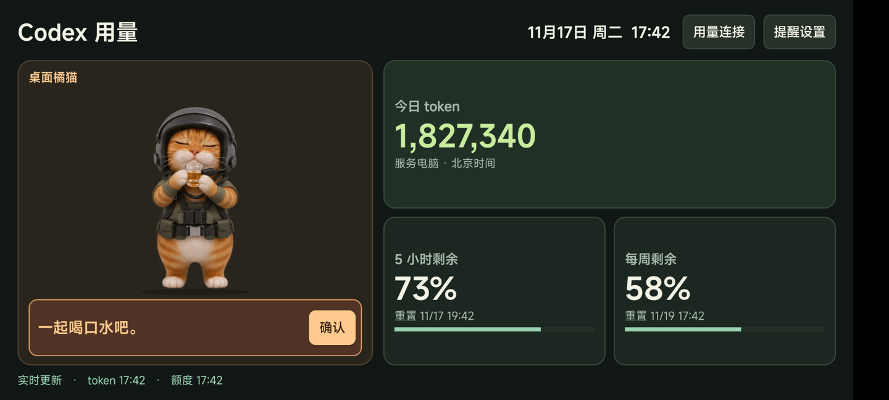

# 橘猫看板

红米上的 **橘猫看板**是原生 Android 应用，支持 Android 11 或更高版本。打开后进入反向横屏，前台显示时屏幕保持常亮。空闲时，橘猫会随机等 45–75 秒，再从挥爪、眨眼、打哈欠、闪身步、浪子踢球和狗熊哆嗦毛里选一个动作。三个舞步分别有八张完整姿势。点一下可以摸摸它。看板同时显示北京时间、Codex 用量和下一项提醒。

## 界面截图



| 自定义用量连接 | 喝水提醒 |
| --- | --- |
|  |  |

截图使用演示用量和示例服务地址。

## 宠物动作

| 闪身步 | 浪子踢球 | 狗熊哆嗦毛 |
| --- | --- | --- |
|  |  |  |

## 开始使用

1. 从 [GitHub Releases](https://github.com/KeyOfTheQuestion/codex-cat-dashboard/releases/latest) 下载 APK，安装到 Android 11 或更新版本的设备。
2. 在运行 Codex 的电脑上安装 Node.js 22 或更新版本和 [Codex CLI](https://learn.chatgpt.com/docs/cli)，执行 `codex login` 登录自己的 ChatGPT 账号。
3. 克隆此仓库并按下方任一种方式启动用量服务。

   ```bash
   git clone https://github.com/KeyOfTheQuestion/codex-cat-dashboard.git
   cd codex-cat-dashboard
   ```

### macOS 和 ADB

1. 为手机打开调试，确认 `adb devices` 能看到设备。双击 **启动看板.command**，脚本会启动本机用量服务，建立 ADB 转发并打开手机 App。
2. App 右上角 **用量连接** 的默认地址是 `http://127.0.0.1:8765`。电脑和手机通过 ADB 转发连接。
3. 无线调试重连时，在手机查看当前连接地址，在 Mac 终端运行下列命令并替换地址。

   ```bash
   ./启动看板.command 手机IP:连接端口
   ```

首次无线配对时，在手机选择「使用配对码配对设备」，在 Mac 终端执行 `adb pair 手机IP:配对端口` 并输入手机显示的配对码，再运行启动命令。

双击 **停止看板.command** 可停止 Mac 服务。要退出手机看板，可从屏幕边缘滑出系统栏再返回桌面。

### 自定义用量服务地址

电脑和手机在同一个可信局域网时，可以在电脑终端前台运行以下命令。也可在公共网络部署 HTTPS 反向代理，再转发到本机服务。

```bash
export CODEX_DISPLAY_HOST=0.0.0.0
export CODEX_DISPLAY_PORT=8765
export CODEX_DISPLAY_TOKEN="$(openssl rand -hex 32)"
printf '%s\n' "$CODEX_DISPLAY_TOKEN"
node server.mjs
```

在手机打开 **用量连接**，填入电脑的局域网地址，例如 `http://192.168.1.20:8765`，再填写上一步生成的访问令牌。也支持 HTTPS 地址、反向代理的路径前缀和完整的 `/api/usage` 地址。启动服务的终端需要保持运行。令牌用于读取统计，重新生成后要同步修改手机端。

从互联网访问时，用 HTTPS 提供 `GET /api/usage`，服务可保留默认回环监听并设置 `CODEX_DISPLAY_TOKEN`。反向代理需要向上游转发 `Authorization` 请求头，并在使用路径前缀时将外部路径映射到 `/api/usage`。局域网 HTTP 会明文传送令牌和统计，请用于信任的网络。

服务端默认只监听 `127.0.0.1:8765`。监听非回环地址时必须设置 `CODEX_DISPLAY_TOKEN`。启用令牌后，每个用量请求都需要 `Authorization: Bearer <访问令牌>`。App 的 **恢复默认** 可返回 ADB 转发地址。

## 桌面提醒

点 **提醒设置** 可以调整喝水、拉伸或新增定时待办。喝水默认每天 09:00–19:00，每小时一次。拉伸默认每天 10:30–18:30，每两小时一次。所有时间按北京时间处理。

到点后会显示静音气泡。橘猫在喝水提醒时举杯喝水，在拉伸提醒时抬起前爪伸懒腰，待办到点时挥爪。喝水和拉伸采用对齐的完整姿势逐帧播放，在伸展或啜饮时短暂停留。点橘猫可以重播当前提醒动作。点 **确认** 时橘猫会举爪回应，单次待办随即移除。提醒由手机本地计时，Mac 断开时仍能在前台看板显示。原生 App 和旧网页各自保存提醒设置。

## 数据口径

- **5 小时和每周剩余**取自 [Codex App Server 账户额度](https://developers.openai.com/codex/app-server/)，约每 30 秒查询一次。用 100% 减去已用比例，重置时间按北京时间显示。
- **今日 token**每 5 秒扫描服务电脑的 Codex 会话事件，按北京时间自然日累加会话 token 增量。使用 Codex 日志记录的总数，包含已缓存输入，覆盖这台电脑有相应日志的用量。其他设备的活动会体现在账户额度中，其会话 token 不计入本机累计。
- App 每 5 秒读取统计。连接中断时显示状态并保留最后一次读取的数字，连接恢复后继续更新。用量接口只返回汇总数字、额度和更新时间。

## 网页入口和重新构建

使用默认本机模式时，运行 `./启动看板.command --web` 可在手机打开旧网页。要在电脑浏览器查看，可运行 `node server.mjs`，再打开 `http://127.0.0.1:8765/`。

原生源码位于 `android/`。在 macOS 安装 JDK 21、Android SDK Platform 34 和 Build-Tools 34.0.0 后运行 **构建安卓.command** 可重新生成 APK。非默认 SDK 路径可用 `ANDROID_HOME` 指定。脚本使用当前电脑的本地签名密钥，自行构建的 APK 需要使用同一密钥才能覆盖安装。

运行 `node --test` 可验证用量 HTTP 接口和本机用量统计。

感谢 [LINUX DO](https://linux.do/) 为开源项目提供交流空间。
